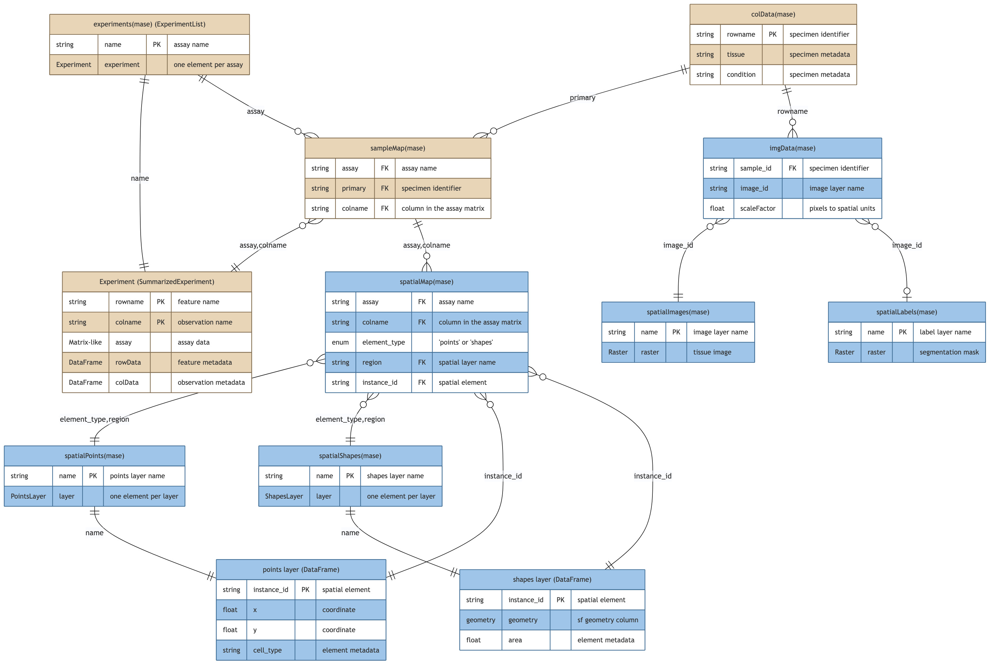

```{r setup, include = FALSE}
knitr::opts_chunk$set(
  collapse = TRUE,
  comment = "#>"
)
```

```{r libs, message = FALSE}
library(MultiAssaySpatialExperiment)
library(SummarizedExperiment)
library(S4Vectors)
```

# Scope

This vignette is for readers who want to know how a `MultiAssaySpatialExperiment`
is put together: which slots exist, what the mapping tables mean, and which
invariants the class maintains. For day-to-day use start with
*Introduction to MultiAssaySpatialExperiment*, which works through a complete
example, and *Working with MultiAssaySpatialExperiment* for construction and
subsetting recipes.

# Anatomy of a MultiAssaySpatialExperiment

A MASE object has three parts. It **inherits** the assays, specimen metadata and
`sampleMap` of a `MultiAssayExperiment`. It **adds** four spatial element layers:
points, shapes, images and labels. And it carries one extra mapping table,
`spatialMap`, that says where in space each assay column sits, alongside `imgData`,
which associates specimens with images.

The quickest way to see all three is to build a small object and take it apart.

```{r construct_minimal}
mat <- matrix(rnorm(20), nrow = 5, ncol = 4,
  dimnames = list(paste0("Gene", 1:5), paste0("Cell", 1:4)))

pts <- DataFrame(
  x = c(1.2, 2.5, 3.1, 4.8),
  y = c(1.5, 2.3, 3.7, 4.2),
  instance_id = paste0("Cell", 1:4))

mase <- MultiAssaySpatialExperiment(
  experiments = ExperimentList(rna = mat),
  colData = DataFrame(row.names = paste0("Cell", 1:4)),
  sampleMap = DataFrame(
    assay = factor("rna", "rna"),
    primary = paste0("Cell", 1:4),
    colname = paste0("Cell", 1:4)
  ),
  points = PointsLayerList(coords = pts),
  spatialMap = DataFrame(
    assay = factor("rna", "rna"),
    colname = paste0("Cell", 1:4),
    element_type = "points",
    region = factor("coords", "coords"),
    instance_id = paste0("Cell", 1:4)
  )
)

mase
```

## What it inherits from MultiAssayExperiment

The assays live in an `ExperimentList`, one element per assay. Elements may be plain
matrices, or any class supporting `[` and `colnames()`: `SummarizedExperiment`,
`SingleCellExperiment`, `SpatialExperiment`, or `SpatialFeatureExperiment`.

```{r anatomy_inherited}
experiments(mase)
colData(mase)
sampleMap(mase)
```

`colData` holds one row per **specimen**, the biological unit, and its row names are
the primary identifiers. An **observation** is an assay column: a cell, spot or bin.
Those are different things, and `sampleMap` is what relates them:

| Column | Type | Description |
|--------|------|-------------|
| `assay` | factor | Name of the assay in `ExperimentList` |
| `primary` | character | Row name in `colData` (specimen identifier) |
| `colname` | character | Column name in the assay |

Each row reads "column X of assay Y belongs to specimen Z". Several assay columns may
map to one specimen, which is how replicates and multi-assay specimens are expressed.

## The spatial layers it adds

Each spatial slot is a named list, so a single object can carry several layers of the
same kind: cell centroids and transcript locations as two points layers, say, or cell
boundaries and tissue regions as two shapes layers.

| Slot | Accessor | Class | Each element is |
|------|----------|-------|-----------------|
| `points` | `spatialPoints()` | `PointsLayerList` | a `DataFrame` with `x`, `y` and `instance_id` (plus `z` or annotations) |
| `shapes` | `spatialShapes()` | `ShapesLayerList` | a `DataFrame` with an `sf` `geometry` column and `instance_id` |
| `images` | `spatialImages()` | `RasterLayerList` | a raster: an array, a `terra` `SpatRaster`, or a path on disk |
| `labels` | `spatialLabels()` | `RasterLayerList` | a raster whose pixel values are instance identifiers |

```{r anatomy_spatial}
spatialPoints(mase)
spatialPoints(mase)[["coords"]]

# empty in this minimal object, but the accessors always exist
spatialShapes(mase)
spatialImages(mase)
```

## The tables that tie observations to space

`spatialMap` is the piece that makes the container more than a bag of slots. It is a
five-column `DataFrame`:

| Column | Type | Description |
|--------|------|-------------|
| `assay` | factor | Name of the assay in `ExperimentList` |
| `colname` | character | Column name in the assay |
| `element_type` | character | Which spatial slot: `"points"` or `"shapes"` |
| `region` | character | Layer name within that slot (e.g. `"coords"`, `"cells"`) |
| `instance_id` | character | Row identifier within that layer |

```{r anatomy_spatialmap}
spatialMap(mase)
```

Each row reads "column X of assay Y is located at row Z of layer W". Because the link
is a table rather than a slot on the assay, several assays can share one set of
geometries, and subsetting the object rewrites this table so the links stay consistent
instead of leaving orphaned geometry behind.

The triple `(element_type, region, instance_id)` resolves to a row of
`slot(mase, element_type)[[region]]`, and validity requires that every `spatialMap` row
matches a `sampleMap` row on `(assay, colname)` and that every `instance_id` exists in
the layer it names.

`imgData` plays the same role for images, with one row per image-specimen pair:
`sample_id` (a `colData` row name), `image_id` (a name in the `images` slot),
`scaleFactor` for pixel-to-coordinate conversion, and, once loaded, the raster payload
or file reference in `data`, `width`, `height` and `path`.

## The relational schema

Putting those together, the object is a small relational schema:

```{r mase_erd, echo = FALSE, out.width = "100%", fig.cap = "Entity-relationship diagram of the MASE schema. Tan entities are inherited from MultiAssayExperiment; blue entities are added by MASE."}

```

Each box is one accessor's return value, and its rows are that object's columns, with
`PK` marking an identifying column and `FK` one that points at another box. The line
endings are standard crow's-foot notation:

a double bar means *exactly one*, a circle-and-bar means *zero or one*, a crow's foot
with a circle means *zero or more*, and a crow's foot with a bar means *one or more*.

So the line from `colData` to `sampleMap` reads "one specimen has zero or more
`sampleMap` rows", which is the replicate case described above.

For construction beyond this minimal example, including multi-assay objects, shapes,
images and labels, and the validity errors you are likely to hit first, see the
*Working with MultiAssaySpatialExperiment* vignette.

# Session info

```{r sessionInfo}
sessionInfo()
```
